University: ITMO University<br>
Faculty: FTMI<br>
Course: Облачные платформы как основа технологического предпринимательства<br>
Year: 2025/2026<br>
Group: U4125<br>
Author: Shishkina Sofya Anatolievna<br>
Lab: Lab1<br>
Date of create: 07.11.2026<br>
Date of finished:


# Лабораторная работа №1

Работа по обзору Google Cloud и исследованию основных сервисов.

# Цель работы

Ознакомиться с основными возможностями и преимуществами облачной платформы Google Cloud.

# Ход работы

- Зайдите в вкладку IAM, создайте service account с ролью Storage Admin.

> В качестве нейминга используйте первую букву имени и фамилию, а также добавьте -sa-lab1. Например Ivan Filianin = ifilianin-sa-lab1.

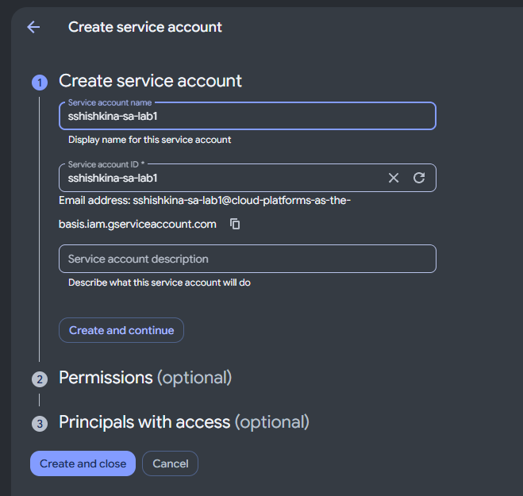

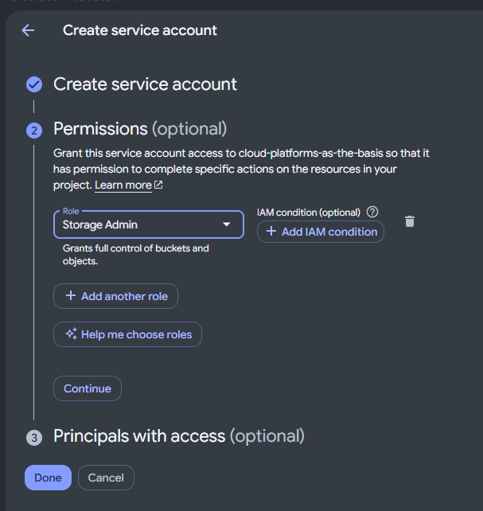

- Создать минимальный compute engine (виртуальную машину) с Machine type e2-micro в режиме spot.

> В качестве нейминга используйте первую букву имени и фамилию, а также добавьте -vm-lab1. Например Ivan Filianin = ifilianin-vm-lab1.

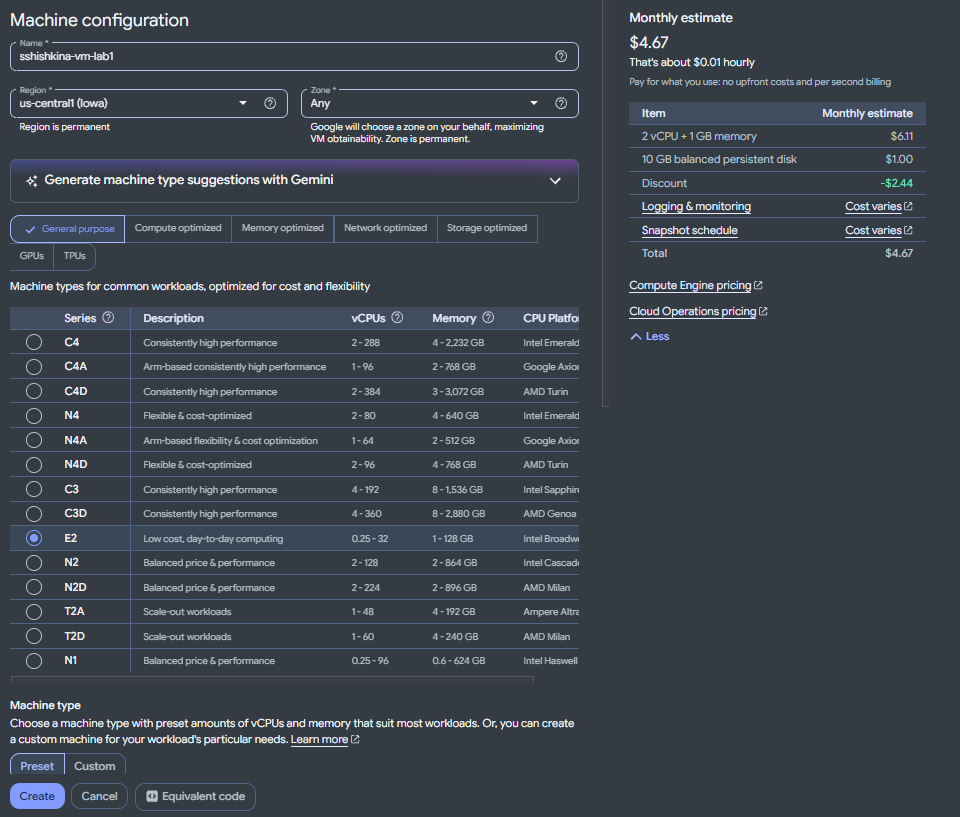

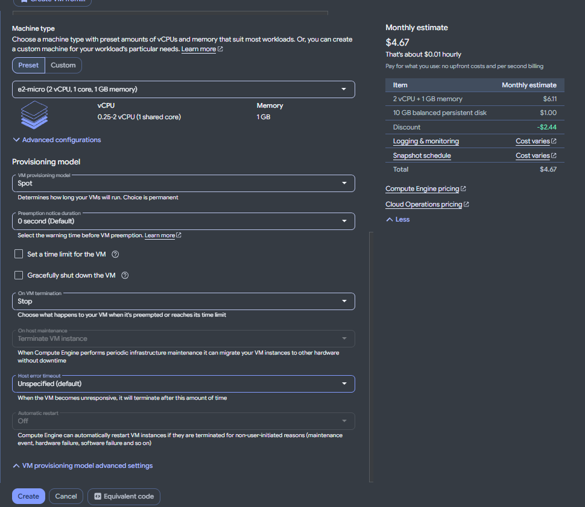

Также прописан Service Account sshishkina-sa-lab1 с `Access scope` "Allow full access to all Cloud APIs:":

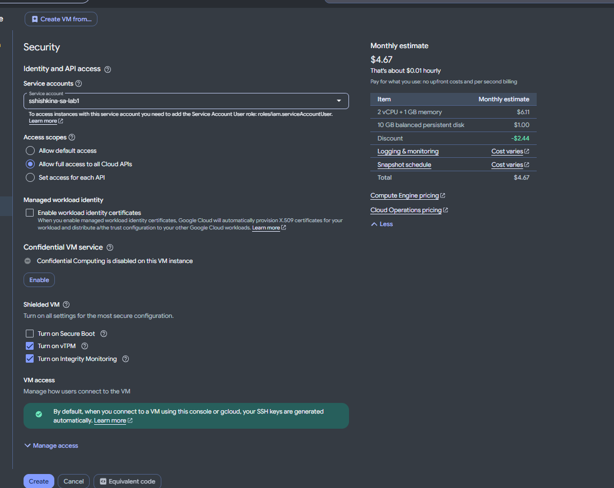

С помощью утилиты gcloud найдите бакет lab1-bucket-itmo и скопируйте 3 файла в локальную папку на VM. Используя команду ls -lah отобразите что эти файлы хранятся у вас на VM.

Для этого октроем подключение по `ssh` в браузере:

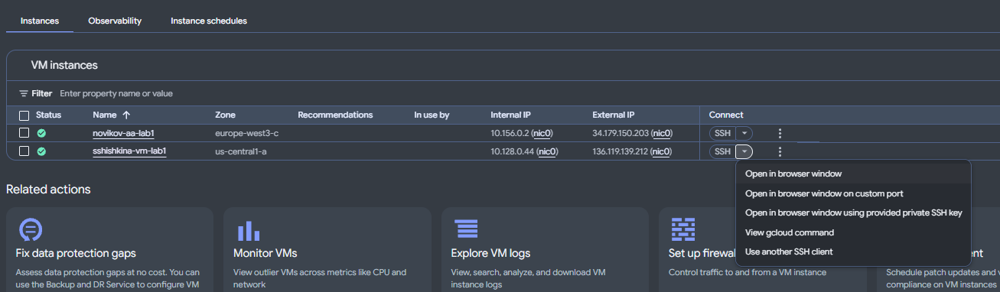

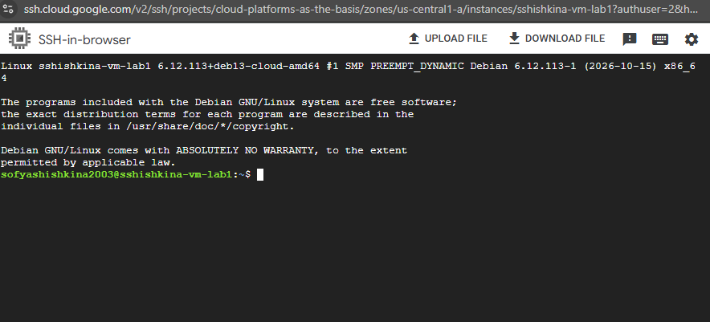

Для просмотра файлов в бакете воспользуемся командой `gcloud storage ls gs://BUCKET_NAME`:

```
gcloud storage ls gs://lab1-bucket-itmo/
```

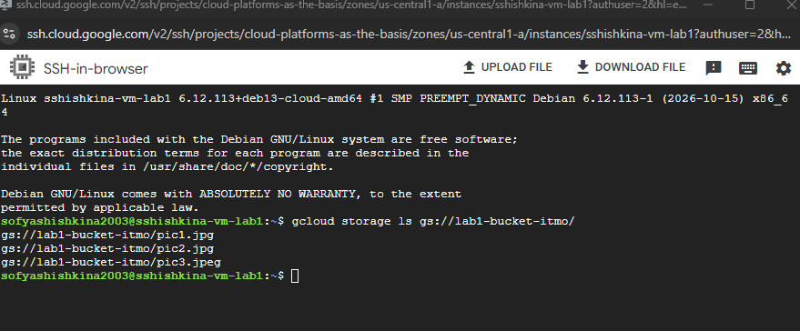

Видим 3 файла. Чтобы скопировать их в папку, создадим с помощью `mkdir` папку, например, `papka`:

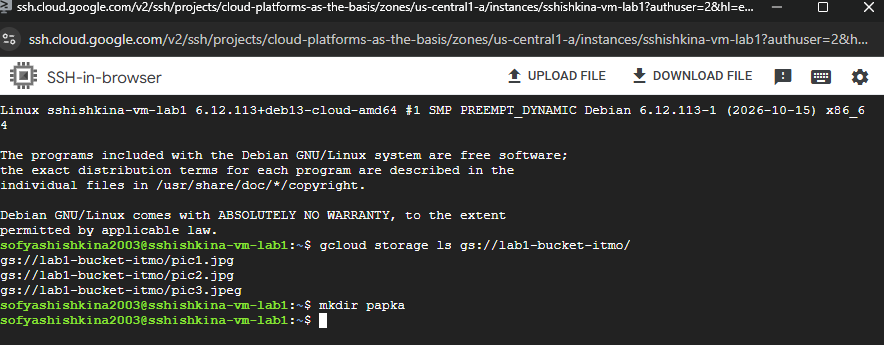

Для копирования файлов выполним команду копирования с помощью `gcloud`:

```
gcloud storage cp gs://lab1-bucket-itmo/pic1.jpg gs://lab1-bucket-itmo/pic2.jpg gs://lab1-bucket-itmo/pic3.jpeg papka
```

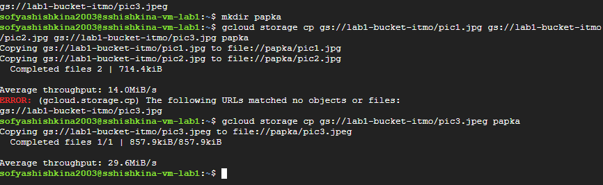

Первые два файла скопировались успешно. При копировании третьего возникла ошибка: вместо `pic3.jpeg` было указано `pic3.jpg`. После исправления имени третий файл также был скопирован.

Теперь перейдём в папку `papka` с помощью `cd` и отобразим файлы в этой директории:

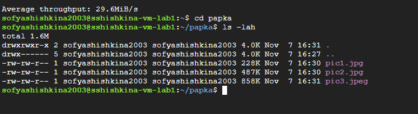

Видим все 3 файла. Каталоги `.` (текущий каталог) и `..` (родительский каталог - `~`) видны из-за флага `-a` в команде `ls`.

- Поменяйте права доступа для вашего service account с `Storage Admin` на `Compute Viewer`, попробуйте повторить пункт с копированием данных, сделать выводы.

Сделаем это в разделе `IAM & Admin`:

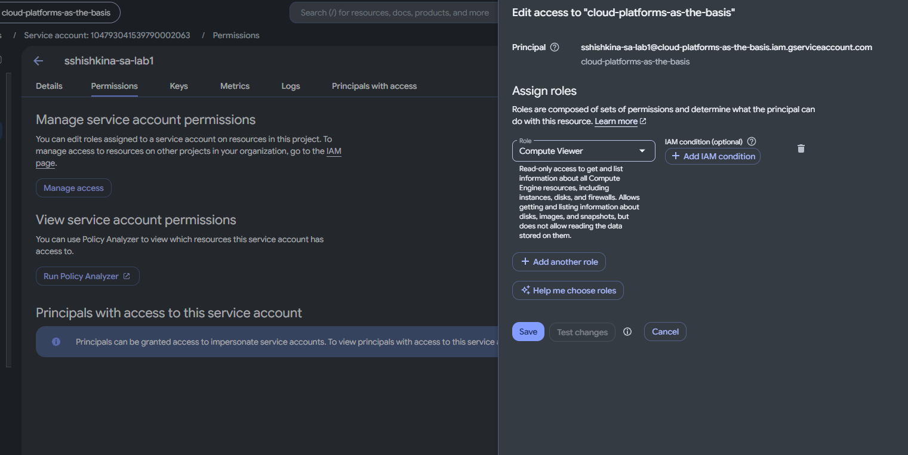

Попробуем ещё раз скопировать файл (скопируем 1 файл):

```
gcloud storage cp gs://lab1-bucket-itmo/pic1.jpg papka
```

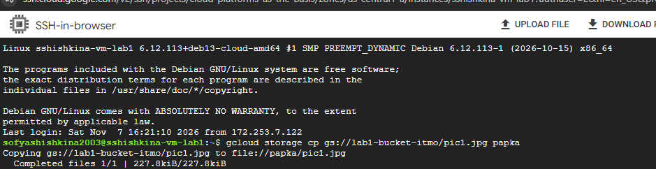

Копировать всё равно даёт. Подождем некоторое время, чтобы настройки применились.

Прождав 10 минут и повторив копирование получаем тот же эффект.

Откроем `Cloud Storage` -> `Buckets` -> `lab1-bucket-itmo` -> `Permissions`:

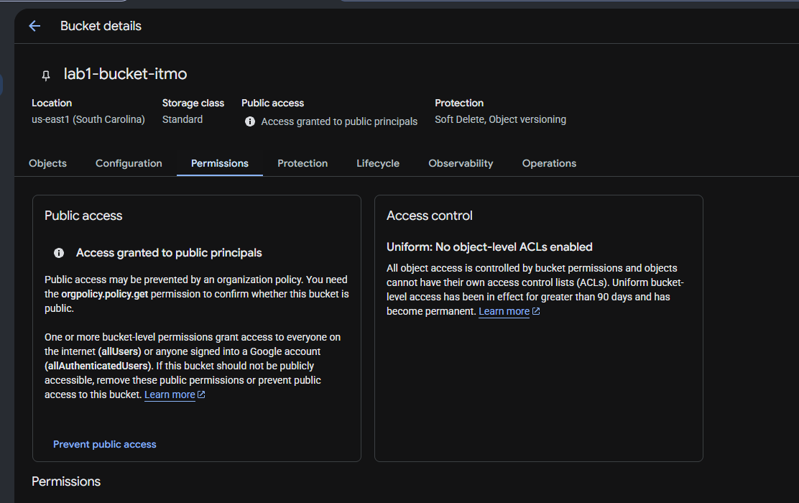

Видим, что на уровне бакета настроены публичные разрешения, которые сохраняют возможность чтения независимо от удалённой роли service account. Роль Compute Viewer сама по себе не предоставляет прав на чтение объектов Cloud Storage.

- Удалите за собой все созданные сервисы.

Для этого удалим машину с названием `sshishkina-vm-lab1` в разделе `https://console.cloud.google.com/compute/instances`.

Также удалим сервисный аккаунт `sshishkina-sa-lab1` в разделе `https://console.cloud.google.com/iam-admin/serviceaccounts`.

# Итог работы

В ходе работы созданы сервисный аккаунт и виртуальная машина Compute Engine. С помощью Google Cloud CLI три файла скопированы из Cloud Storage на VM. После замены роли Storage Admin на Compute Viewer скачивание осталось доступным благодаря публичным разрешениям бакета.

