University: ITMO University 
Faculty: FTMI 
Course: Облачные платформы как основа технологического предпринимательства 
Year: 2025/2026 
Group: U4125 
Author: Shishkina Sofya Anatolievna 
Lab: Lab2 
Date of create: 07.11.2026 
Date of finished:

# Лабораторная работа №2

Работа по исследованию Cloud Run.

# Цель работы

Ознакомиться с работой Cloud Run.

# Ход работы

- Создайте Cloud Run из представленного дефолтного сервиса Hello с минимальным количеством ресурсов.

На экране Cloud Run выберем Deploy container:

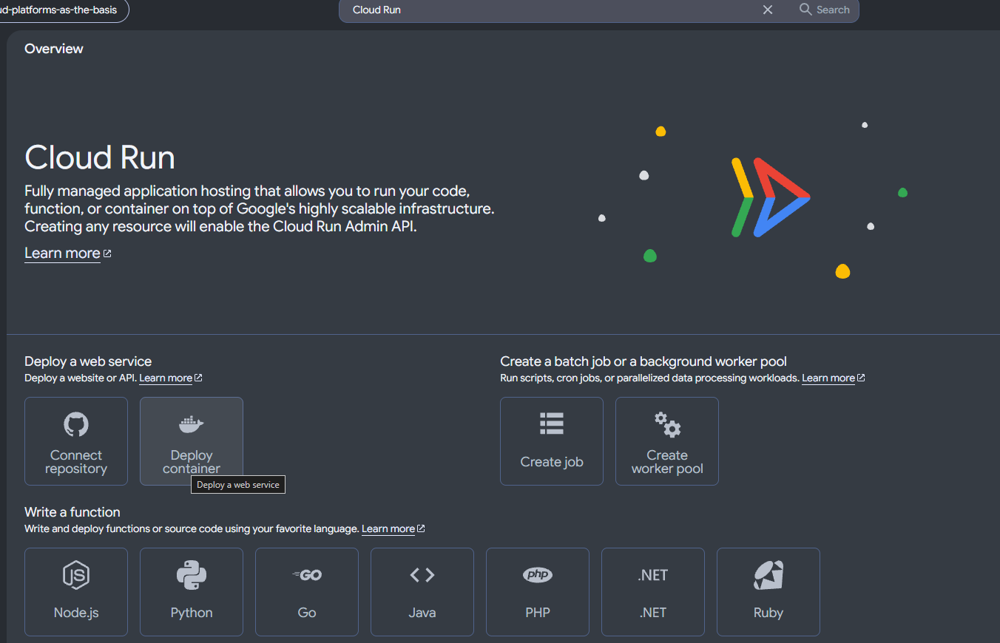

На экране создания выберем контейнер `hello`:

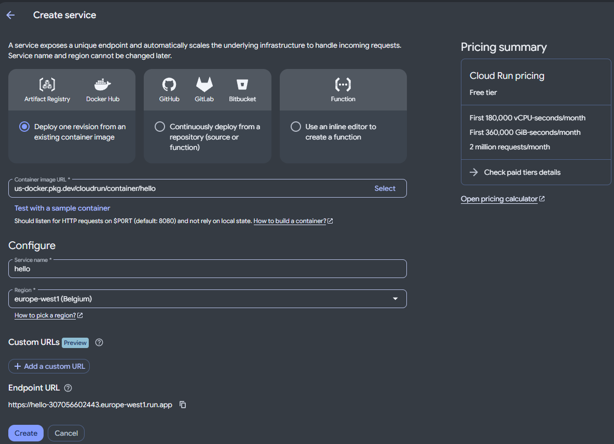

Выберем минимальные ресурсы:

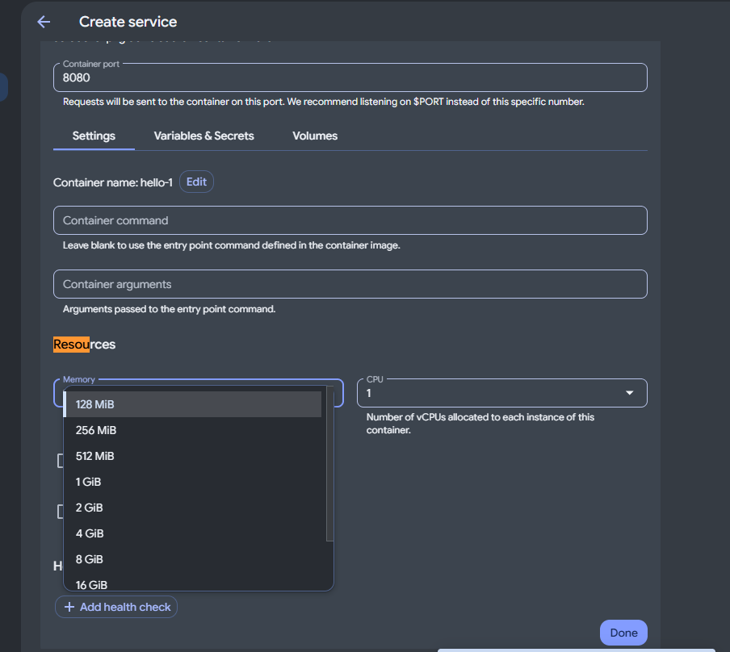

Сервис после запуска:

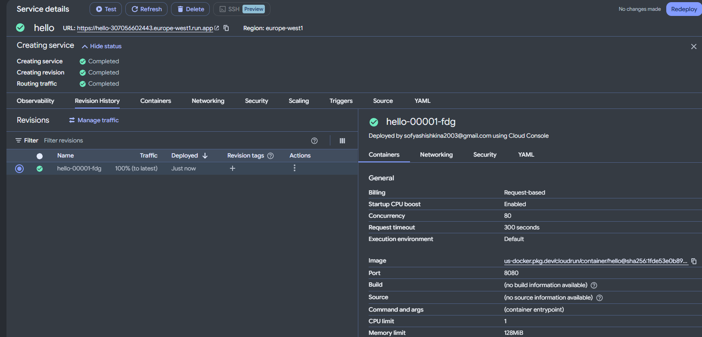

- Перейдите по ссылке, предоставленной Cloud Run, протестируйте сервис.

Перейдя по ссылке `https://hello-307056602443.europe-west1.run.app/` видим - сервис работает:

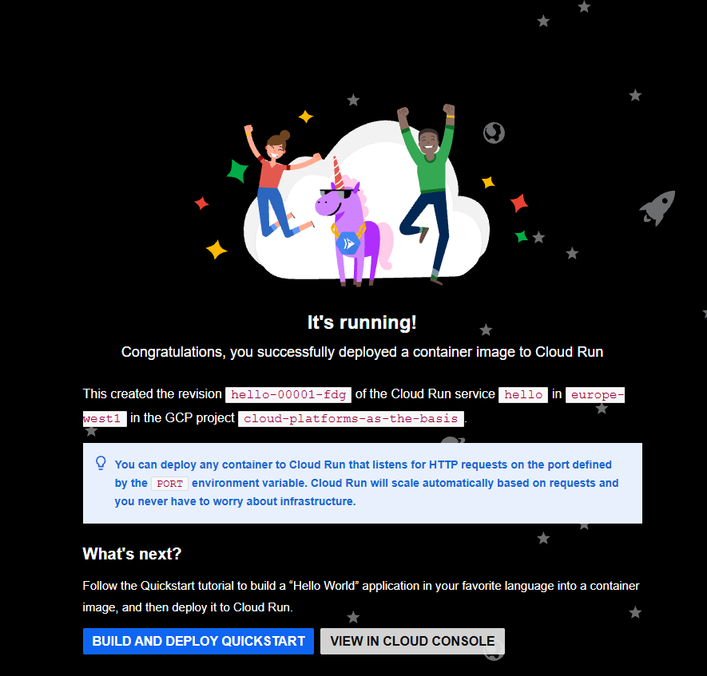

- Перейдите в разделы логи и метрики, проанализируйте их.

Раздел логов:

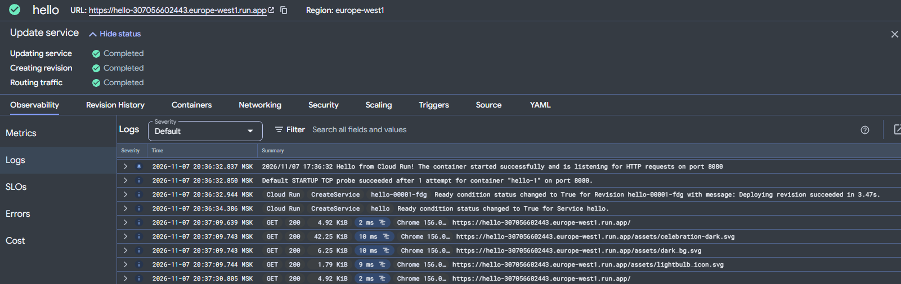

Видим логи старта контейнера и запросов к сервису - отдана страница сервиса и статические файлы - .svg картинки.

Раздел метрик:

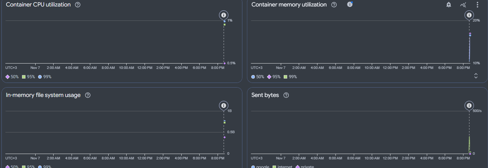

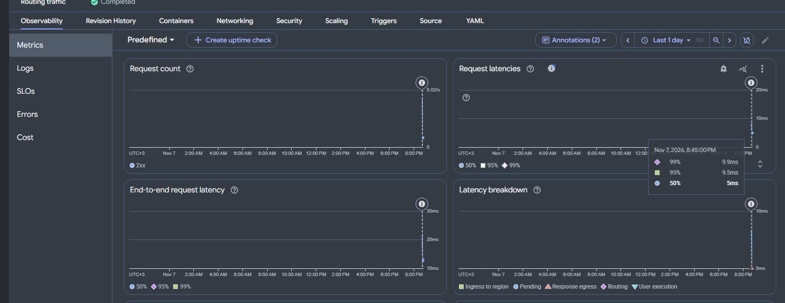

Видим множество разных метрик. Например, количество запросов, задержки по запроса, использование процессора/оперативной памяти/диска, количество отправленных байт.

- Измените Cloud Run, поменяв порт на `8090`. Посмотрите, что произойдёт. Попробуйте переключать трафик между версиями, сравните результаты работы.

Изменим порт и нажмём "View diff & redeploy":

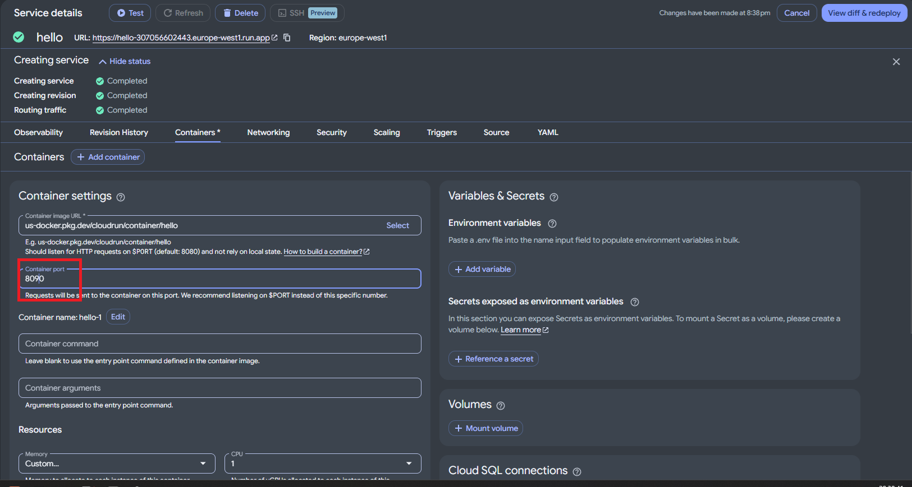

При переходе на страницу сервиса видим, что открылся именно новый, запущенный на порту `8090` - `hello-00002-nrn`:

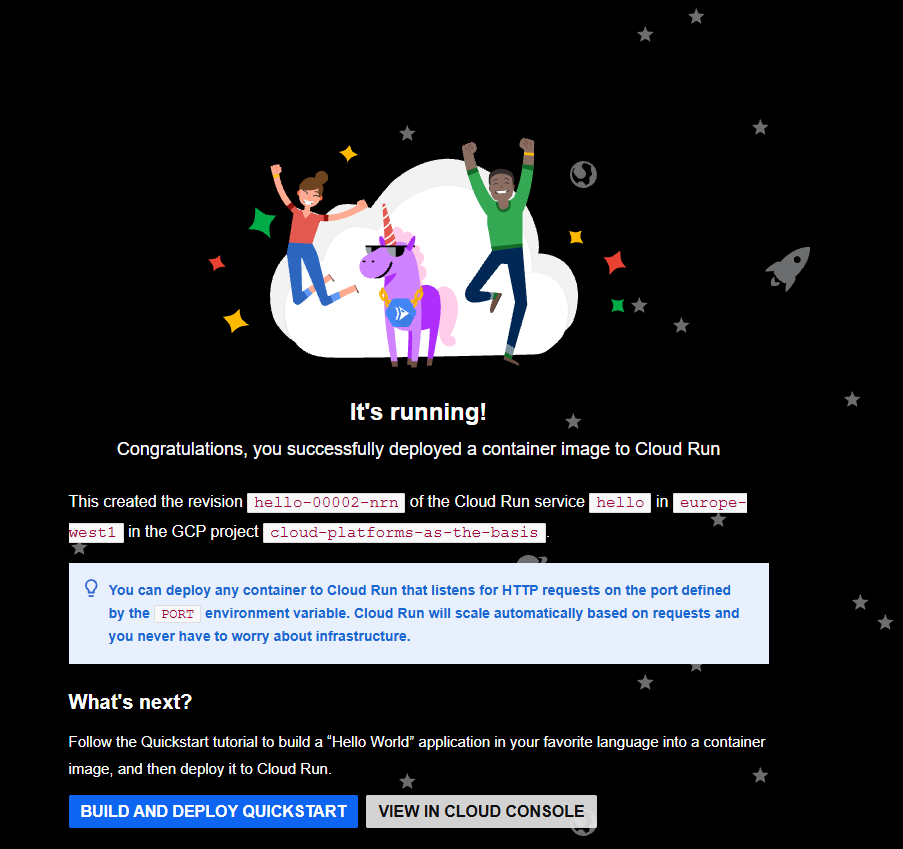

Переключим трафик на 1-ю версию:

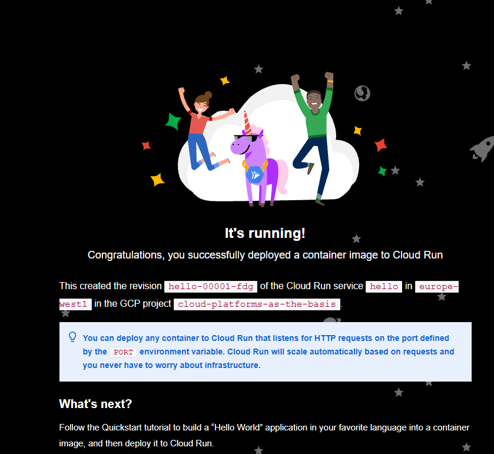

Видим тот же экран, что в первый раз.

- Удалите все созданные сервисы.

Сделаем распределние трафика 50/50 между двумя версиями приложения, запущенных на портах 8080 и 8090:

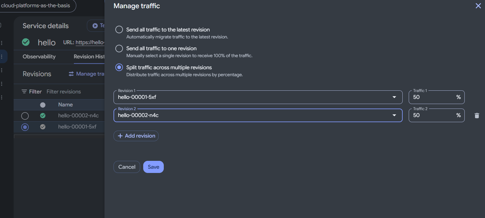

Перейдя на веб страницу приложения, обновим её несколько раз:

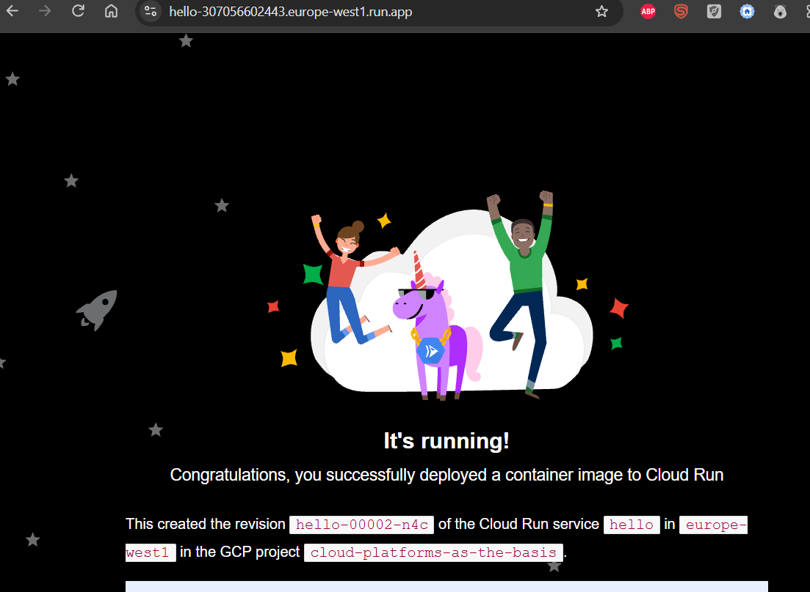

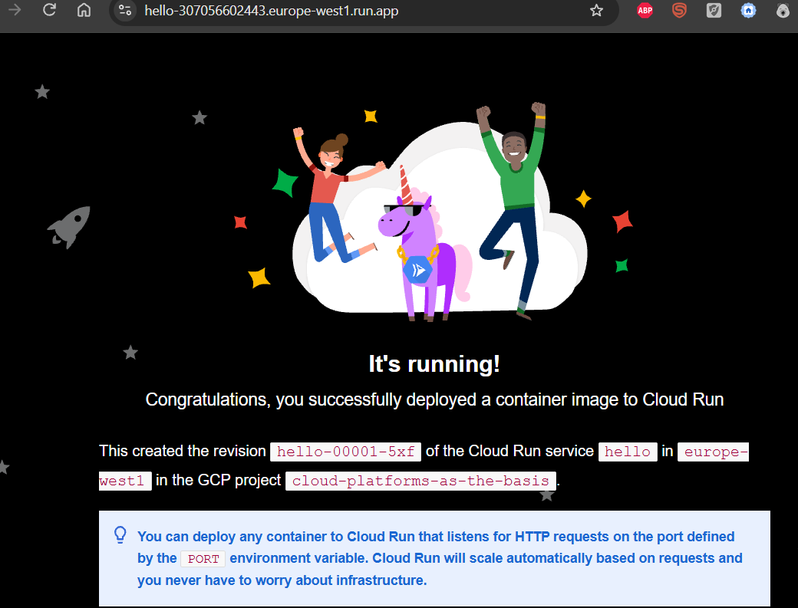

Каждый раз при обновлении страницы видим смену ревизии приложения с `hello-00001-5xf` на `hello-00002-n4c` и наоборот. Однако смена не всегда срабатывает, так как 50% это вероятность, а не сторое задание чередования.

Удалим сервис:

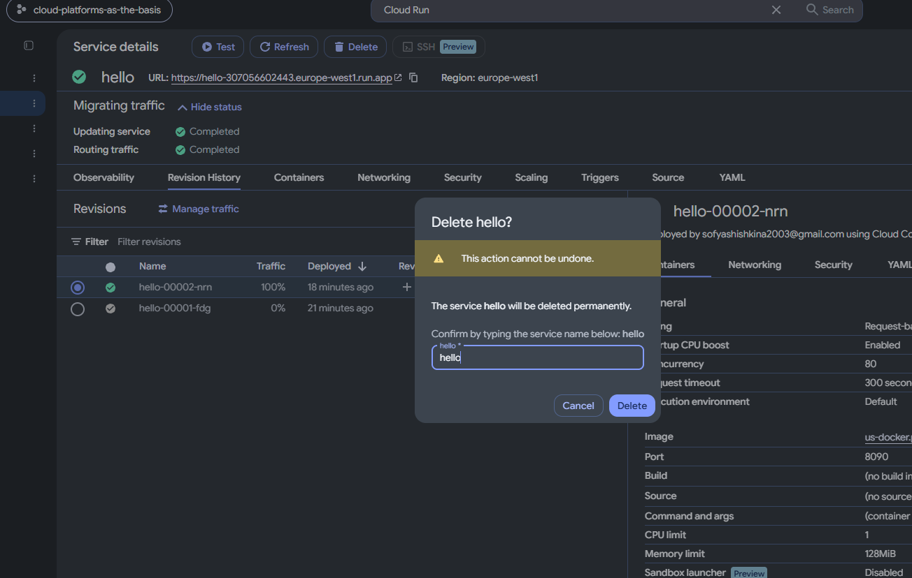

# Итог работы

В ходе работы в Cloud Run развёрнут и протестирован сервис Hello с минимальными ресурсами. Изучены логи запуска контейнера и обработки запросов, а также метрики количества запросов, задержек и использования ресурсов. После изменения порта с `8080` на `8090` создана новая ревизия, при этом сервис сохранил работоспособность. Переключение трафика на исходную ревизию позволило вернуться к предыдущей версии сервиса по тому же URL. При распределении трафика 50/50 между ревизиями они чередуются. После завершения работы сервис удалён.
