University: ITMO University 
Faculty: FTMI 
Course: Облачные платформы как основа технологического предпринимательства 
Year: 2026/2027 
Group: U4125 
Author: Shishkina Sofya Anatolievna 
Lab: Lab3 
Date of create: 07.11.2026 
Date of finished:

# Лабораторная работа №3

Исследование Cloud Storage.

# Цель работы

Ознакомиться с основными понятиями и принципами работы облачного хранилища, изучить модели хранения данных (блочное, файловое и объектное хранилище), познакомиться с основными сервисами и функциональностью облачных хранилищ.

# Ход работы

- Выбрать существующий проект, в котором есть необходимые разрешения.

Работу будем выполнять в проекте `cloud-platforms-as-the-basis`.

- Создать Cloud Storage bucket.

На Welcome-странице выберем "Cloud Storage":

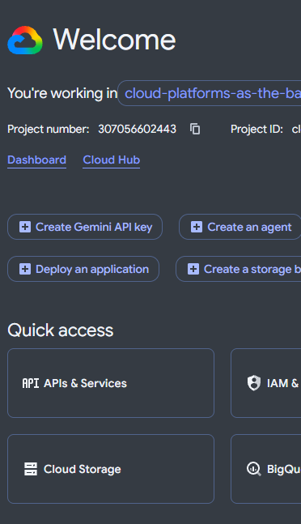

Создадим бакет с параметрами:

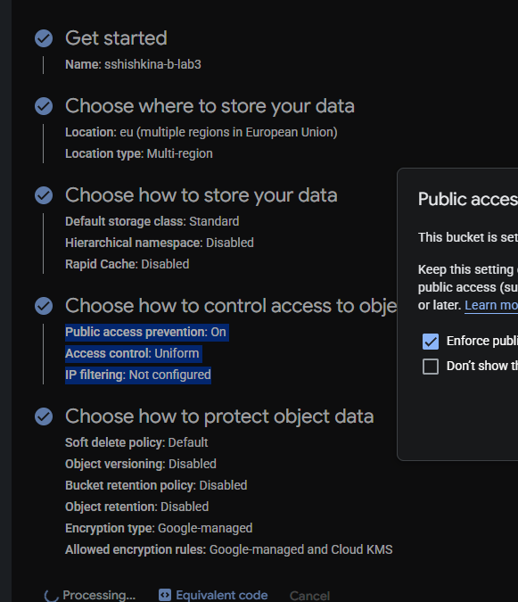

Созданный бакет:

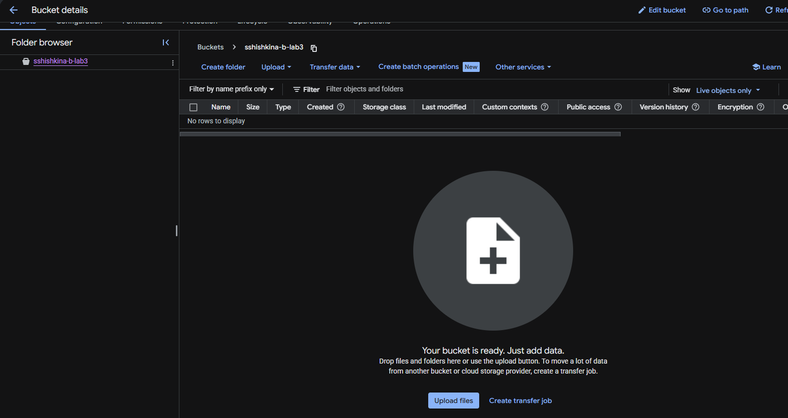

- Загрузить 3–4 любых изображения в бакет.

Загрузим скриншоты для текущей лабораторной:

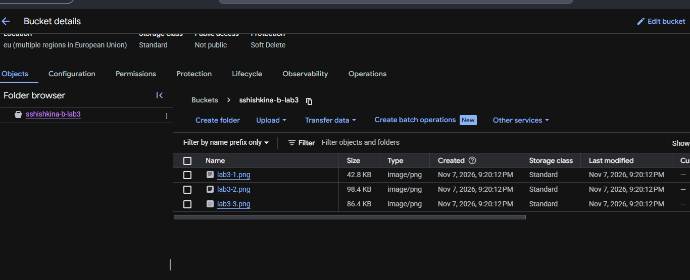

- Создать папку с любым названием и переместить файлы туда в пределах бакета.

Создадим папку:

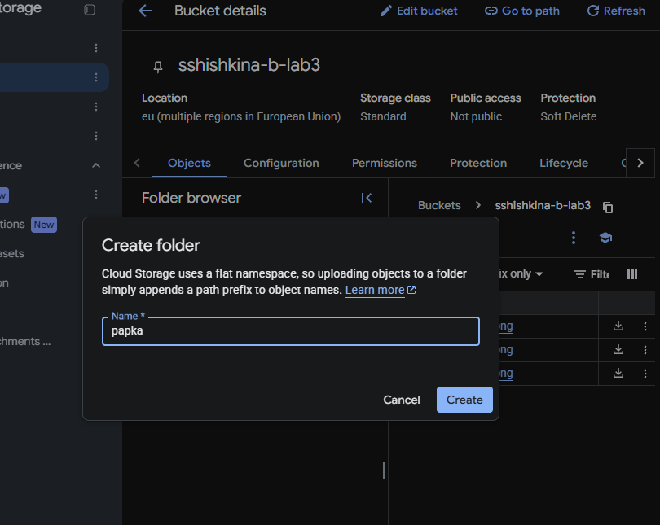

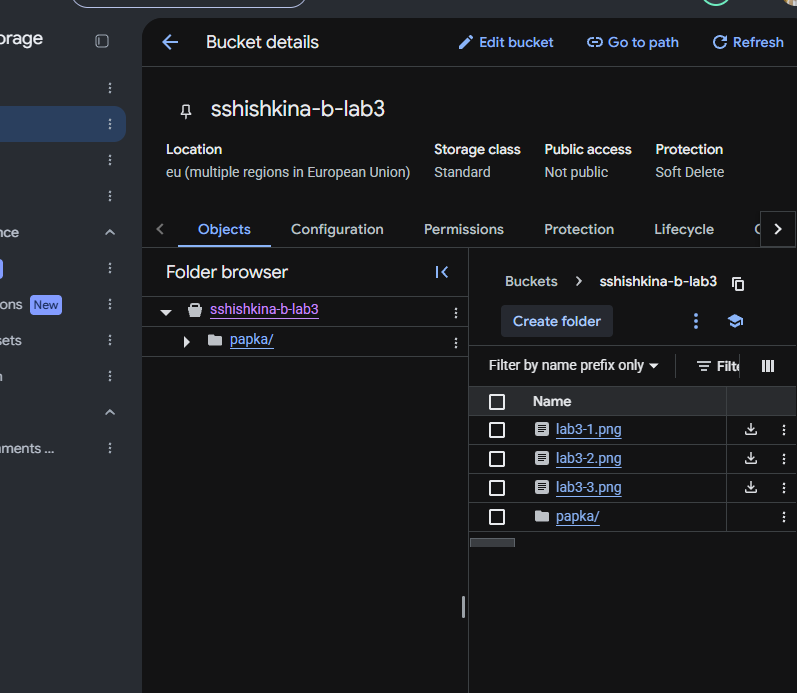

С помощью функции Move переместим каждый файл в папку `papka`:

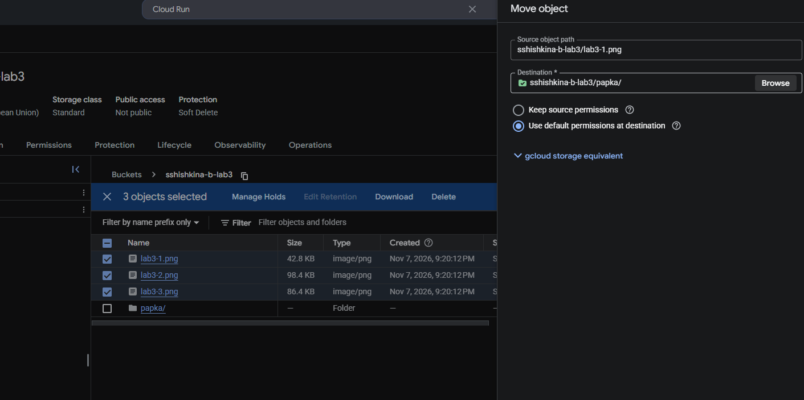

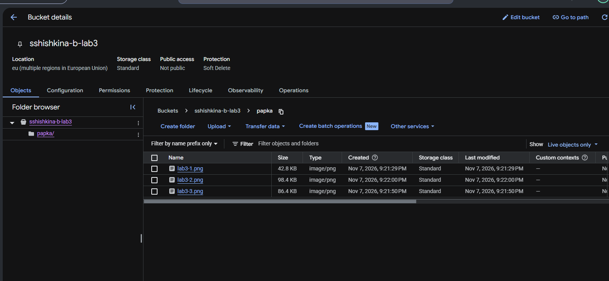

- Настроить публичный доступ для файлов в настройках приватности.

Для этого перейдём в раздел Permissions и нажмём Remove Public Access Prevention:

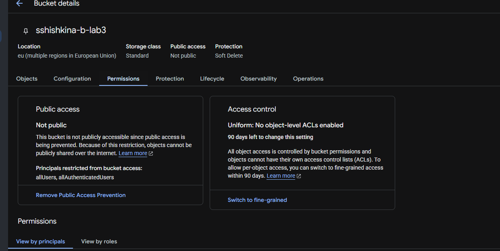

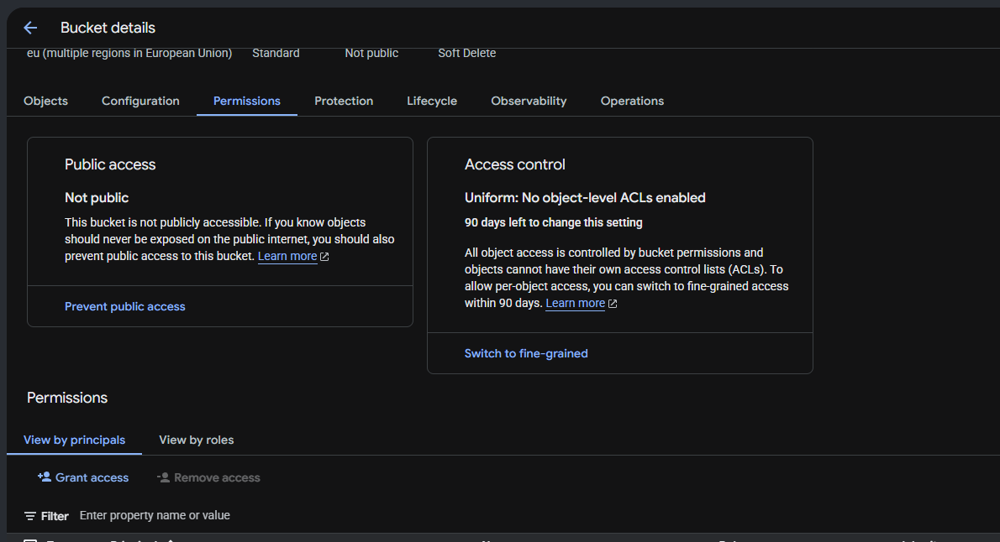

После перейдём в раздел Grant Access и пропишем всем пользователям (allUsers) роль Storage Object Viewer, которая даёт право читать и скачивать объекты бакета, а также просматривать их список:

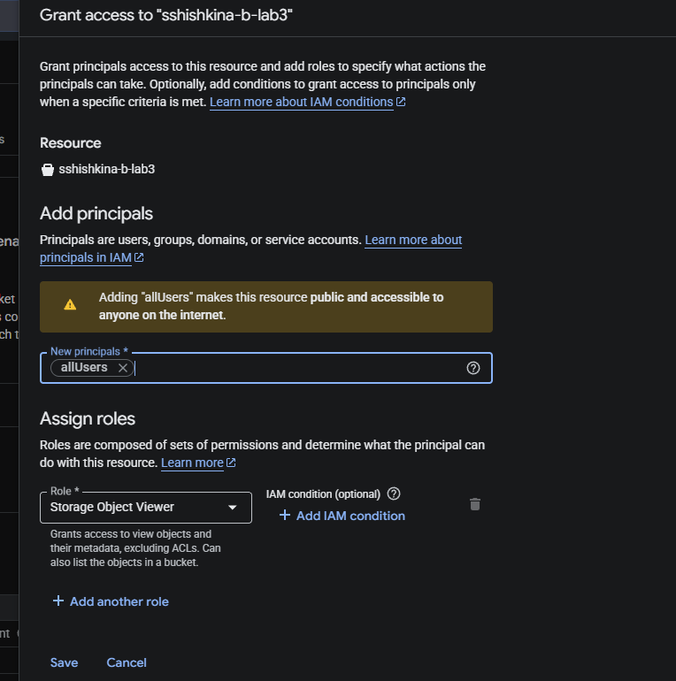

- Создать ссылки на файлы через контекстное меню файла.

Для этого для каждого загруженного файла получим публичную ссылку:

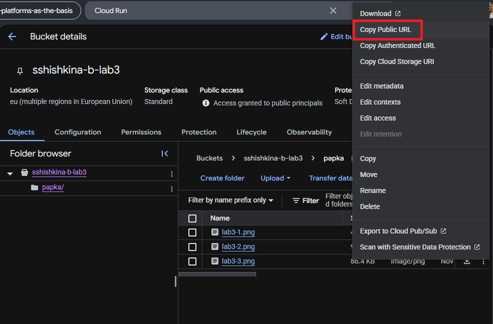

В режиме инкогнито проверяем - все файлы доступны:

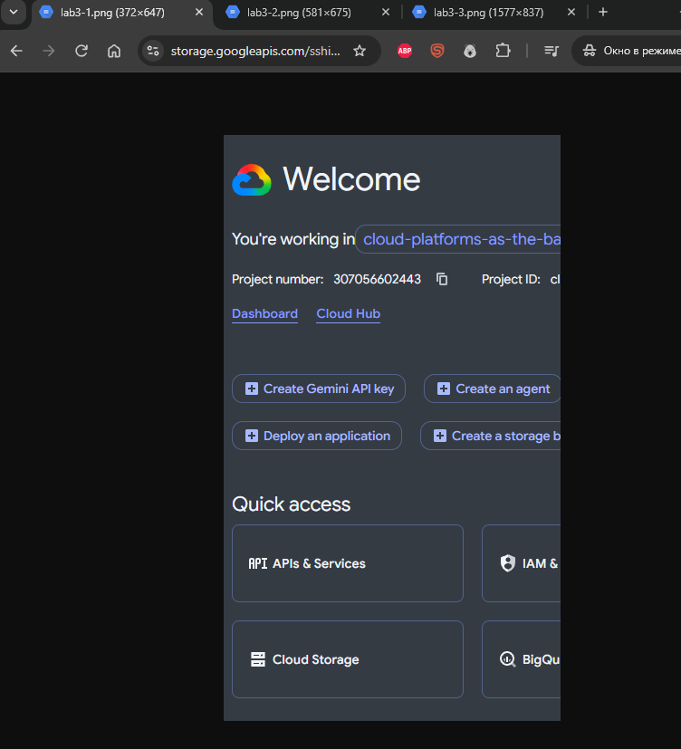

- Удалить все созданные в ходе работы ресурсы.

Удалим созданный бакет:

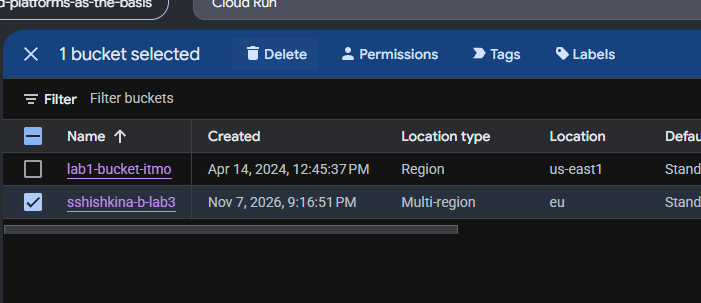

В диалоге подтверждения указано, что для бакета включено мягкое удаление (Soft Delete) со сроком хранения 7 дней. После удаления бакет и его объекты сохраняются для восстановления на этот срок, затем удаляются окончательно.

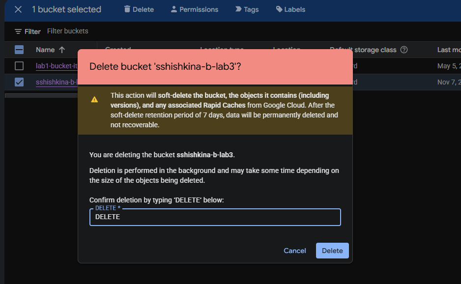

Мягкое удаление не сохраняет публичный доступ к удалённым объектам: для чтения их необходимо восстановить. При этом ранее открывавшиеся публичные изображения могут временно отображаться из кэша. Само по себе открытие ссылки после удаления не подтверждает доступность объекта в бакете.

# Итог работы

В ходе работы в проекте `cloud-platforms-as-the-basis` создан бакет Cloud Storage `sshishkina-b-lab3`. В него загружены три изображения, которые затем перемещены в папку `papka`. Для настройки публичного доступа отключён Public Access Prevention, а группе `allUsers` назначена роль Storage Object Viewer. Получены публичные ссылки на файлы и проверена их доступность без авторизации в режиме инкогнито. Рассмотрено удаление бакета вместе с содержимым и действие политики Soft Delete со сроком хранения 7 дней. На практике изучены загрузка и организация объектов в Cloud Storage, управление доступом и особенности удаления данных.

