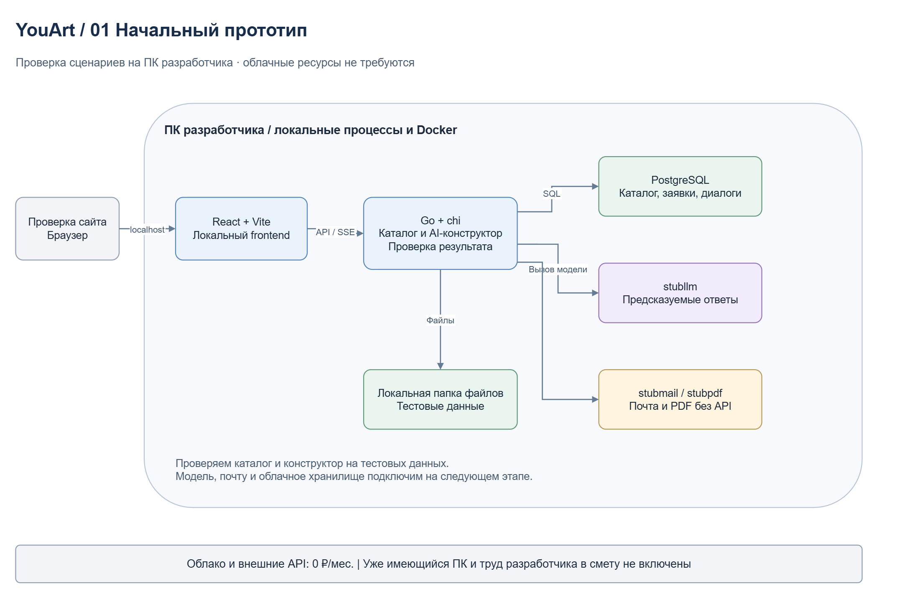
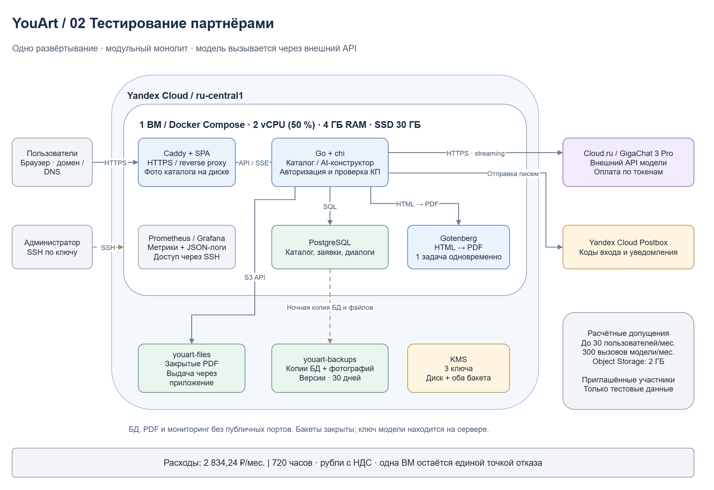
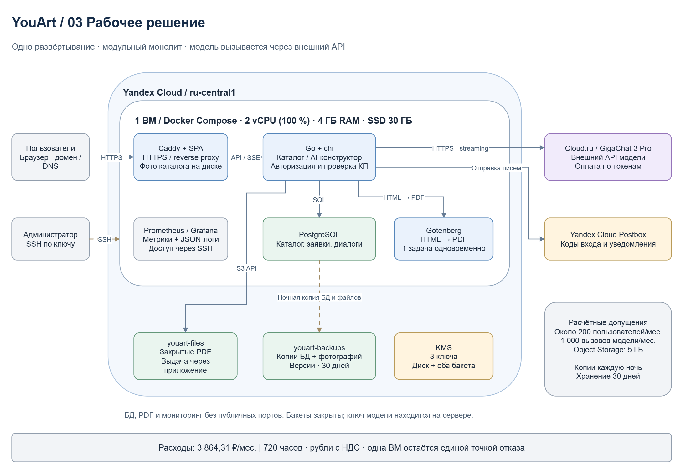

University: ITMO University 
Faculty: FTMI 
Course: Облачные платформы как основа технологического предпринимательства 
Year: 2026/2027 
Group: U4125 
Author: Shishkina Sofya Anatolievna 
Lab: Lab4 
Date of create: 07.11.2026 
Date of finished:

# Лабораторная работа №4

Разработка инфраструктуры MVP AI-приложения на примере ЮАрт - будущего сайта для [творческой мастерской](https://vk.ru/ya.workshop).

# Цель работы

Спроектировать инфраструктуру приложения для трёх этапов: прототипа, тестирования партнёрами и рабочего сайта. Рассчитать расходы и обосновать выбор ресурсов.

# Ход работы

## 1. Исходные данные о приложении

Для работы выбран проект **ЮАрт** - сайт мастерской творческих мастер-классов. Посетитель сможет выбрать занятия в каталоге и отправить заявку. AI-конструктор на GigaChat поможет составить программу мероприятия по пожеланиям пользователя. Результат - коммерческое предложение (КП) на сайте и в PDF. Условия заказа согласует менеджер.

Стек взят из проектной документации YouArt, составленной разработчиком:

| Компонент | Технология или сервис | Назначение |
|---|---|---|
| Серверная часть | Go и chi | Каталог, заявки и AI-конструктор |
| Клиентская часть | React и Vite | Интерфейс сайта |
| База данных | PostgreSQL | Пользователи, каталог, заявки и диалоги |
| Запуск приложения | Docker Compose | Запуск компонентов в контейнерах |
| Веб-сервер | Caddy | HTTPS, раздача файлов и передача запросов приложению |
| Генерация PDF | Gotenberg | Создание PDF коммерческих предложений |
| Облачная инфраструктура | Yandex Cloud | ВМ, файлы и резервные копии |
| Автоматические письма | Yandex Cloud Postbox | Коды входа и уведомления |
| AI-модель | GigaChat через API Cloud.ru | Подбор программы мероприятия |

Базу данных и файлы клиентов разместим в российском регионе Yandex Cloud. Это связано с требованиями к локализации персональных данных граждан РФ при их сборе - [ч. 5 ст. 18 закона № 152-ФЗ, разъяснение Роскомнадзора](https://storage.yandexcloud.net/comply-publicfiles/public/Otvet_RKN_24.03.2025_lokalizatsija.pdf). Данные облака хранятся в [выбранном регионе](https://yandex.cloud/ru/docs/overview/concepts/region). Перед запуском GigaChat через Cloud.ru отдельно проверим условия обработки запросов: пользователь может указать в диалоге личные сведения.

### Нагрузка для расчёта

Сайт ещё не запущен, поэтому статистики нет. Около **200 пользователей в месяц** - ориентир из документации проекта. Для партнёрской проверки условно примем группу из **30 человек**. Остальные значения нужны для сметы и рассчитаны следующим образом:

| Параметр | Начальный прототип | Тестирование партнёрами | Рабочий сайт |
|---|---|---|---|
| Пользователи | Разработчик и руководитель мастерской | 30 человек в месяц | Около 200 человек в месяц |
| Вызовы модели за месяц | Заглушка | 300: по 10 на участника проверки | Около 1 000: треть посетителей × 15 обращений |
| Письма за месяц | Заглушка | До 150: по 5 на человека | До 1 000: по 5 на человека |
| Средний объём Object Storage | Локальные файлы | 2 ГБ | 5 ГБ |
| Исходящий трафик ВМ за месяц | Нет | 3 ГБ | 20 ГБ |

На тестировании все участники проверяют конструктор. Для рабочего сайта предполагаем, что им воспользуется примерно треть посетителей. Один вызов модели - один ответ; 10-15 ответов заложим на уточнение пожеланий и изменение программы. Пять писем на человека предусмотрим для кодов входа и уведомлений, трафик оценим из расчёта 100 МБ на посетителя в месяц.

Хранилище рассчитано на 30 ежедневных копий БД и файлы КП. Для тестирования примем размер сжатой копии 50 МБ: за месяц получится около 1,5 ГБ, ещё 0,5 ГБ оставим для PDF и архивов фотографий. Для рабочего сайта заложим копии по 100 МБ - около 3 ГБ за месяц, плюс 2 ГБ для остальных файлов и их версий. Фактические объёмы уточним после запуска.

## 2. Схемы инфраструктуры

В [файле draw.io](diagrams/youart-infrastructure.drawio) три страницы - по одной на каждый этап.

### 2.1. Начальное состояние

Разработчик и руководитель мастерской проверят каталог и конструктор на тестовых данных. Приложение и PostgreSQL запустим на компьютере разработчика. Вызовы модели, почту и PDF заменим заглушками - компонентами, которые возвращают заранее подготовленный результат. Облако и домен на этом этапе не нужны.

### 2.2. Тестирование партнёрами

Для доступа через интернет выберем одну ВМ в Yandex Cloud: **2 vCPU Intel Ice Lake с гарантированной долей 50 %, 4 ГБ RAM и SSD 30 ГБ**. Доля 50 % относится к гарантированной производительности каждого ядра. На ВМ запустим приложение, Caddy, PostgreSQL и Gotenberg.

Подключим GigaChat 3 Pro через Cloud.ru, отправку писем через Postbox и Object Storage для PDF и резервных копий. Партнёры проверят весь сценарий: от описания мероприятия до получения КП и письма.

### 2.3. Рабочий сайт

Сохраним ту же ВМ и увеличим гарантированную долю CPU до **100 %**, чтобы обеспечить больше ресурсов для БД и создания PDF. Это стартовая конфигурация: её достаточность проверим на партнёрском этапе.

В Object Storage создадим два закрытых бакета: `youart-files` для PDF и `youart-backups` для копий БД и фотографий. Копии будем делать каждую ночь и хранить 30 дней. Для шифрования диска и двух бакетов предусмотрим три ключа KMS.

Caddy будет принимать HTTPS-запросы, отдавать сайт и фотографии. БД и служебные компоненты останутся без публичного доступа. Prometheus и Grafana на той же ВМ помогут следить за работой сайта.

Если ВМ выйдет из строя, сайт будет недоступен до восстановления. Ночные копии позволят вернуть данные, но изменения за последние сутки могут потеряться.

## 3. Расчёт расходов

### 3.1. Тарифы

Тарифы проверены **07.11.2026**. Возьмём месяц из 30 дней - **720 часов** круглосуточной работы. Цены указаны в рублях с НДС, без стартовых грантов и скидок облака.

| Ресурс | Ставка | Источник |
|---|---|---|
| Intel Ice Lake, 50 % vCPU | 0,75 ₽ за vCPU·ч | [Прайс Compute Cloud](https://yandex.cloud/ru/price-list?services=dn22pas77ftg9h3f2djj) |
| Intel Ice Lake, 100 % vCPU | 1,24 ₽ за vCPU·ч | [Compute Cloud](https://yandex.cloud/ru/docs/compute/pricing) |
| RAM Intel Ice Lake | 0,33 ₽ за ГБ·ч | [Compute Cloud](https://yandex.cloud/ru/docs/compute/pricing) |
| Сетевой SSD `network-ssd` | 0,0199 ₽ за ГБ·ч | [Прайс Compute Cloud](https://yandex.cloud/ru/price-list?services=dn22pas77ftg9h3f2djj) |
| Публичный IPv4 у работающей ВМ | 0,26352 ₽/ч | [VPC](https://yandex.cloud/ru/docs/vpc/pricing) |
| Object Storage, стандартный класс | 2,376 ₽ за ГБ в месяц, первый 1 ГБ бесплатно | [Object Storage](https://yandex.cloud/ru/docs/storage/pricing) |
| Активная версия симметричного ключа KMS | 0,00439 ₽/ч | [KMS](https://yandex.cloud/ru/docs/kms/pricing) |
| Криптографические операции KMS | 3,16 ₽ за 10 000 | [KMS](https://yandex.cloud/ru/docs/kms/pricing) |
| Postbox | Первые 2 000 писем в месяц бесплатно | [Postbox](https://yandex.cloud/ru/docs/postbox/pricing) |
| GigaChat 3 Pro: входные токены | 73,0292 ₽ за 1 млн | [Тариф Cloud.ru, версия 261029, строки 450-451](https://cdn.cloud.ru/docs/legal/tariffs/evolution/current-version/foundation-models.pdf) |
| GigaChat 3 Pro: генерируемые токены | 176,3876 ₽ за 1 млн | [Тариф Cloud.ru](https://cdn.cloud.ru/docs/legal/tariffs/evolution/current-version/foundation-models.pdf) |
| Домен `.ru`, продление | 399 ₽ в год, в смете 33,25 ₽/мес. | [Timeweb](https://timeweb.com/ru/services/domains/prolongation/) |

Для модели используем тариф Cloud.ru: на эту площадку направляет новых клиентов [инструкция GigaChat для ИП и организаций](https://developers.sber.ru/docs/ru/gigachat/legal-quickstart).

### 3.2. Стоимость вызовов модели

Размер реального запроса пока неизвестен. Для сметы примем **5 000 входных и 500 выходных токенов** на ответ. Вход включает инструкцию, каталог и историю диалога.

Стоимость одного ответа:

`5 000 / 1 000 000 × 73,0292 + 500 / 1 000 000 × 176,3876 = 0,4533398 ₽`.

На тестировании: `300 × 0,4533398 = 136,00 ₽/мес.`

Для рабочего сайта: `1 000 × 0,4533398 = 453,34 ₽/мес.`

Чем длиннее каталог и переписка, тем больше расход токенов. После пробных диалогов расчёт нужно уточнить.

### 3.3. Месячная смета

| Статья | Начальный прототип, ₽ | Тестирование партнёрами, ₽ | Рабочее решение, ₽ |
|---|---:|---:|---:|
| vCPU | 0,00 | `2 × 0,75 × 720` = 1 080,00 | `2 × 1,24 × 720` = 1 785,60 |
| 4 ГБ RAM | 0,00 | `4 × 0,33 × 720` = 950,40 | 950,40 |
| 30 ГБ SSD | 0,00 | `30 × 0,0199 × 720` = 429,84 | 429,84 |
| Активный публичный IPv4 | 0,00 | `0,26352 × 720` = 189,73 | 189,73 |
| Object Storage | 0,00 | `(2 − 1) × 2,376` = 2,38 | `(5 − 1) × 2,376` = 9,50 |
| Три активные версии ключей KMS | 0,00 | `3 × 0,00439 × 720` = 9,48 | 9,48 |
| 10 000 операций KMS, оценка | 0,00 | 3,16 | 3,16 |
| Письма Postbox | 0,00 | 0,00 | 0,00 |
| Интернет-трафик ВМ | 0,00 | 0,00 | 0,00 |
| Операции и интернет-трафик Object Storage | 0,00 | 0,00 | 0,00 |
| GigaChat 3 Pro | 0,00 | 136,00 | 453,34 |
| Домен, распределение продления на 12 месяцев | 0,00 | 33,25 | 33,25 |
| **Итого** | **0,00** | **2 834,24** | **3 864,31** |
| **Плановый бюджет с запасом 20 %** | **0,00** | **3 401,09** | **4 637,17** |

Суммы рассчитаны без промежуточного округления. Запас 20 % предусмотрен на рост потребления; это дополнительный бюджет.

Письма и трафик укладываются в бесплатные объёмы: [Postbox](https://yandex.cloud/ru/docs/postbox/pricing) - 2 000 писем, [VPC](https://yandex.cloud/ru/docs/vpc/pricing) - 100 ГБ трафика в месяц. Для [Object Storage](https://yandex.cloud/ru/docs/storage/pricing) также предполагаем расход в пределах включённых 10 000 операций загрузки и просмотра списка файлов, 100 000 операций чтения и 100 ГБ интернет-трафика. Бесплатный 1 ГБ хранения учитывается один раз для двух бакетов. В расчёте считаем, что бесплатные объёмы не заняты другими проектами.

Домен оплачивается за год, в таблице его продление распределено на 12 месяцев. Разработка, работа менеджера и содержание уже имеющегося компьютера в смету не входят. Для локального прототипа платежей облаку нет.

## 4. Обоснование выбора ресурсов

| Решение | Зачем оно нужно |
|---|---|
| Одна ВМ | На ней разместим все компоненты небольшого сайта. Отдельный сервер для каждого компонента пока не планируется |
| 4 ГБ RAM | Память делят приложение, PostgreSQL, создание PDF и мониторинг. Проверим их совместную работу на испытаниях |
| SSD 30 ГБ | Для ОС, контейнеров, рабочей БД, фотографий и логов; копии будут храниться отдельно |
| PostgreSQL на той же ВМ | Позволяет обойтись без отдельной оплаты сервера БД. Обновления и резервное копирование настраивает разработчик |
| Object Storage | Сохраняет резервные копии при потере ВМ и хранит PDF отдельно от рабочего диска |
| GigaChat через API | При расчётной нагрузке модель стоит около 453 ₽ в месяц. Собственный сервер с GPU и обучение модели не требуются |

При переходе от прототипа к рабочему сайту сохраним Go, PostgreSQL и контейнеры. Подключим настоящие сервисы вместо заглушек и увеличим ресурсы ВМ - переносить приложение на другой стек не потребуется.

Если памяти или процессора станет не хватать, увеличим параметры ВМ. При росте числа PDF их создание можно вынести на отдельный сервер. Если потребуется работа сайта при отказе одной ВМ, понадобится несколько серверов и резервирование БД - это отдельный расчёт.

# Итог работы

Для ЮАрт подготовлены три схемы инфраструктуры, рассчитаны расходы и объяснён выбор ресурсов. Локальный прототип не требует платежей облаку. Тестирование партнёрами обойдётся примерно в **2 834 ₽/мес.**, рабочий сайт - в **3 864 ₽/мес.** С запасом 20 % бюджет рабочего сайта составит около **4 637 ₽/мес.** Все значения нагрузки - допущения для расчёта. Облачные ресурсы в этой работе не создавались.
